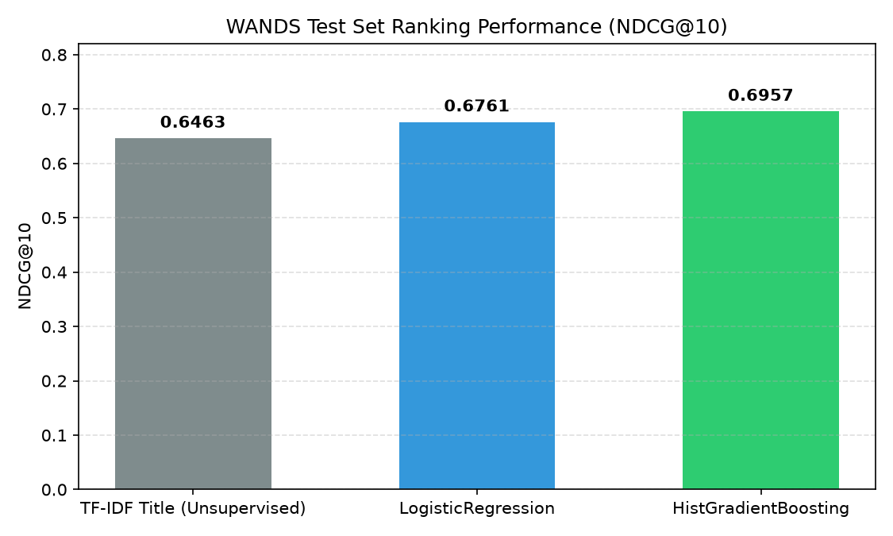

# E-Commerce Search Relevance & Learning-to-Rank (Wayfair WANDS)

An end-to-end, reproducible **E-Commerce Search Relevance & Ranking** project built on Wayfair's open-source [WANDS](https://github.com/wayfair/WANDS) dataset (`233,448` labeled `(query, product)` pairs across `480` queries and `42,986` products) using **DuckDB**, **scikit-learn**, **pandas**, **numpy**, and an interactive **Streamlit** demo UI — no PyTorch, neural embeddings, or heavy dependencies required.

---

## Highlights

- **Leakage-Free Evaluation:** Splits data `70% / 15% / 15%` (`336 / 72 / 72` queries) grouped strictly by `query_id` (`GroupShuffleSplit`) and fits `TfidfVectorizer`s on the `train` split only.
- **DuckDB SQL Feature Engineering:** Computes catalog and text length statistics (`title_word_count`, `desc_word_count`, `category_product_count`, `query_word_count`) directly from raw TSV files in [`sql/features.sql`](wands-search-ml/sql/features.sql).
- **3-Model Benchmark:** Compares an unsupervised **TF-IDF Title Cosine Similarity** baseline against **LogisticRegression** and **HistGradientBoostingClassifier** using `NDCG@10`, `MRR@10 (Exact)`, `RMSE`, and `Macro-F1`, plus a **short (1–2 words) vs. long (3+ words)** query breakdown.
- **Interactive Streamlit Demo (`app.py`):** Side-by-side comparison of TF-IDF vs. ML Ranker on any custom query or test-set preset (`<70 ms` warm query latency on CPU) with ground-truth badges (`Exact`, `Partial`, `Irrelevant`) and a per-feature explainability table.

---

## Observed Test Results (72 Queries, 33,732 Pairs)

### Overall Model Comparison

| Model | NDCG@10 | MRR@10 (Exact) | RMSE | Macro-F1 |
| :--- | :---: | :---: | :---: | :---: |
| TF-IDF Title (Unsupervised) | 0.6463 | 0.3950 | — | — |
| LogisticRegression | 0.6761 | 0.4699 | 0.5392 | 0.3838 |
| **HistGradientBoosting** | **0.6957** | **0.5080** | 0.5978 | **0.4768** |

### Query Length Breakdown (Short: 21 queries, Long: 51 queries)

| Model | Short NDCG@10 (1–2w) | Long NDCG@10 (3+w) | Short MRR@10 | Long MRR@10 |
| :--- | :---: | :---: | :---: | :---: |
| TF-IDF Title (Unsupervised) | 0.6763 | 0.6339 | 0.6524 | 0.2890 |
| LogisticRegression | 0.7424 | 0.6488 | 0.6577 | 0.3926 |
| **HistGradientBoosting** | **0.7657** | **0.6669** | **0.6921** | **0.4322** |



---

## Project Structure

```text
├── .gitignore
├── README.md
└── wands-search-ml/
    ├── app.py                   # Interactive Streamlit demo (TF-IDF vs. ML Ranker)
    ├── requirements.txt
    ├── README.md
    ├── artifacts/
    │   ├── metrics_summary.csv  # Test-set metrics table
    │   └── ndcg_comparison.png  # NDCG@10 bar chart
    ├── models/                  # Pre-trained TF-IDF vectorizers, HGB/LogReg models, & catalog
    ├── sql/
    │   └── features.sql         # DuckDB SQL query for label mapping & catalog/text stats
    ├── src/
    │   ├── prepare_data.py      # Load WANDS, run DuckDB SQL, GroupShuffleSplit by query_id
    │   ├── train_eval.py        # Feature engineering, model training, NDCG@10/MRR@10 eval
    │   └── error_analysis.py    # Inspect worst test queries & diagnose failure modes
    └── tests/
        └── test_checks.py       # Pytest: no query_id leakage, valid NDCG range, no NaNs
```

---

## Quickstart

### 1. Install Dependencies
```bash
cd wands-search-ml
pip install -r requirements.txt
```

### 2. Launch the Interactive Demo (Uses Pre-Trained `models/`)
```bash
streamlit run app.py
```

### 3. Reproduce the Full Training & Evaluation Pipeline
Clone the WANDS dataset into `wands-search-ml/data/WANDS` and run:
```bash
git clone --depth 1 https://github.com/wayfair/WANDS.git data/WANDS
python src/prepare_data.py
python src/train_eval.py
python src/error_analysis.py
```

### 4. Run Automated Tests
```bash
pytest tests/test_checks.py -v
```

---

## Key Findings & Error Analysis

- **What worked:** Combining DuckDB catalog/length stats (`title_word_count`, `desc_word_count`, `category_product_count`, `query_word_count`) with train-only TF-IDF title/description similarities and lexical overlap improved `NDCG@10` from **0.6463** to **0.6957** and `MRR@10` from **0.3950** to **0.5080**, with the largest gains on long 3+ word queries (`MRR@10`: `0.2890` → `0.4322`).
- **What failed:** Lexical features struggle with **typos/spacing errors** (e.g., `'small loving roomtables'` → `NDCG@10 = 0.0000`), **synonyms** (e.g., `'toddler couch fold out'` missing `'upholstered doll sofa...'` because `couch` ≠ `sofa`), and **attribute-over-head-noun mismatches** (e.g., `'dorel vanity'` ranking *Vanity Lighting* above *Bathroom Vanities*).
- **Next steps:** Add character n-gram TF-IDF or fuzzy edit-distance features for typos, incorporate dense bi-encoder embeddings for synonym matching, and train with a pairwise/listwise ranking objective (e.g., LambdaMART).

---

## Deployment

You can deploy the Streamlit UI for free on **Streamlit Community Cloud** or **Hugging Face Spaces**:
- **Entrypoint:** `wands-search-ml/app.py`
- **Dependencies:** `wands-search-ml/requirements.txt`
- Because pre-trained `wands-search-ml/models/` are included in the repository, the app starts in ~1.6 seconds with no training step required.
