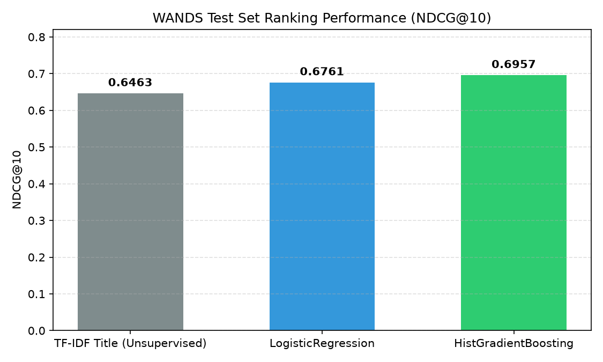

# E-Commerce Search Relevance & Ranking (WANDS)

A clean, beginner-friendly yet rigorous search relevance and learning-to-rank project built on Wayfair's open-source **WANDS** dataset (`https://github.com/wayfair/WANDS.git`) using **DuckDB**, **scikit-learn**, **pandas**, and **numpy** — no PyTorch, neural embeddings, or heavy libraries required.

## Project Structure

```text
wands-search-ml/
├── data/                   # WANDS dataset files & processed parquet splits (gitignored)
├── sql/
│   └── features.sql        # DuckDB SQL query for label mapping, product & query stats
├── src/
│   ├── prepare_data.py     # Load WANDS, run DuckDB SQL, GroupShuffleSplit by query_id
│   ├── train_eval.py       # TF-IDF baseline, LogisticRegression, HistGradientBoosting + NDCG@10
│   └── error_analysis.py   # Print worst test queries & diagnose failure modes
├── tests/
│   └── test_checks.py      # Pytest: no query_id leakage, valid metric range, no NaNs
├── artifacts/              # Saved metrics summary & NDCG@10 bar chart
├── requirements.txt
└── README.md
```

## Setup & Usage

1. **Install dependencies:**
   ```bash
   pip install -r requirements.txt
   ```

2. **Clone the WANDS dataset** into `data/WANDS`:
   ```bash
   git clone --depth 1 https://github.com/wayfair/WANDS.git data/WANDS
   ```

3. **Prepare data & leakage-free splits** (70% train / 15% val / 15% test grouped by `query_id`):
   ```bash
   python src/prepare_data.py
   ```
   - Total labeled pairs: **233,448** across **480** unique queries (`Exact=2`: 25,614; `Partial=1`: 146,633; `Irrelevant=0`: 61,201).
   - `train`: 157,767 rows (336 queries) | `val`: 41,949 rows (72 queries) | `test`: 33,732 rows (72 queries).

4. **Train models & evaluate ranking:**
   ```bash
   python src/train_eval.py
   ```

5. **Run error analysis on worst test queries:**
   ```bash
   python src/error_analysis.py
   ```

6. **Run the interactive Streamlit demo:**
   ```bash
   streamlit run app.py
   ```
   - **Free Deployment:** Push this repository (including `models/` or running `prepare_data.py` + `train_eval.py` in setup) to GitHub and deploy directly on **Streamlit Community Cloud** (`share.streamlit.io`, entrypoint `app.py`) or **Hugging Face Spaces** (Streamlit SDK).

7. **Run tests:**
   ```bash
   pytest tests/test_checks.py -v
   ```

## Observed Results (Test Split: 72 Queries, 33,732 Pairs)

### Overall Model Comparison

| Model | NDCG@10 | MRR@10 | RMSE | Macro-F1 |
| :--- | :---: | :---: | :---: | :---: |
| TF-IDF Title (Unsupervised) | 0.6463 | 0.3950 | — | — |
| LogisticRegression | 0.6761 | 0.4699 | 0.5392 | 0.3838 |
| **HistGradientBoosting** | **0.6957** | **0.5080** | 0.5978 | **0.4768** |

### Query Length Breakdown (Short: 21 queries, Long: 51 queries)

| Model | Short NDCG@10 (1–2 words) | Long NDCG@10 (3+ words) | Short MRR@10 | Long MRR@10 |
| :--- | :---: | :---: | :---: | :---: |
| TF-IDF Title (Unsupervised) | 0.6763 | 0.6339 | 0.6524 | 0.2890 |
| LogisticRegression | 0.7424 | 0.6488 | 0.6577 | 0.3926 |
| **HistGradientBoosting** | **0.7657** | **0.6669** | **0.6921** | **0.4322** |



## Key Takeaways

- **What worked:** Combining simple DuckDB catalog/length stats (`title_word_count`, `desc_word_count`, `category_product_count`, `query_word_count`) with train-only TF-IDF similarities and lexical overlap features improved `NDCG@10` from **0.6463** (unsupervised TF-IDF) to **0.6957** (`HistGradientBoosting`) and boosted `MRR@10` on `Exact` matches from **0.3950** to **0.5080** (+0.1130), with especially strong gains on long 3+ word queries (`MRR@10` 0.2890 → 0.4322).
- **What failed:** Lexical features struggle with **typos/spacing errors** (e.g., `'small loving roomtables'` → `NDCG@10 = 0.0000`), **synonyms** (e.g., `'toddler couch fold out'` missing `'upholstered doll sofa with foldout bed...'` because `couch` ≠ `sofa`), and **attribute-over-head-noun mismatches** (e.g., `'dorel vanity'` ranking a *Vanity Lighting* fixture above a *Bathroom Vanity*, or `'non slip shower floor tile'` matching a *Shower Faucet* with `'slip-fit'`).
- **What to try next:** Add character n-gram TF-IDF or fuzzy/edit-distance features for typos, incorporate query-class / product-class semantic similarity or **dense bi-encoder embeddings** to bridge synonyms (`couch` ↔ `sofa`), and train a **pairwise/listwise ranking objective** (e.g., LambdaMART) instead of pointwise classification.

